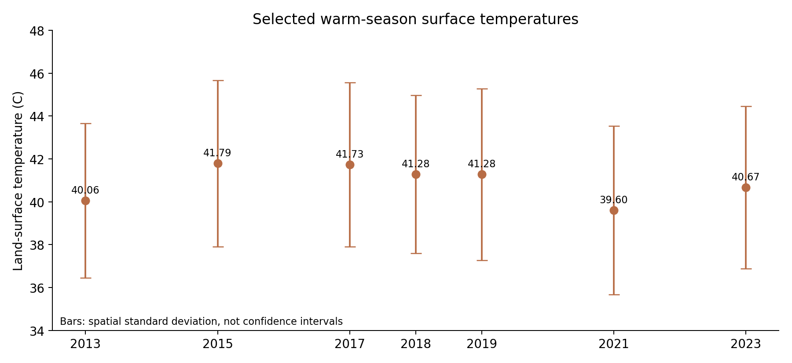
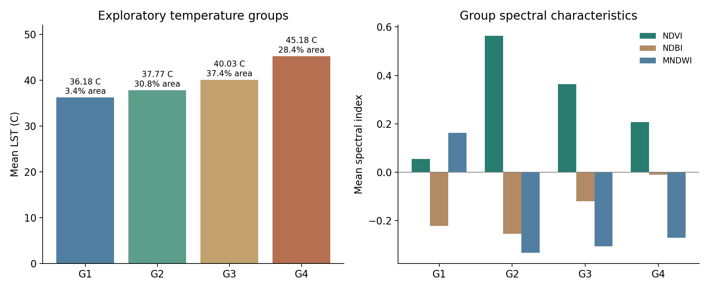

# Multan surface-temperature patterns, 2013-2023

**Landsat 8 · Earth Engine · Spectral indices · Exploratory clustering**

Musab Shahid's undergraduate environmental-science research at Bahauddin Zakariya University examines selected warm-season land-surface temperatures within 25 km of Multan.

## Explore the research

- **[Full FYP report](FYP_Multan_UHI_Report.pdf)** · [Original poster](fyp-canva-poster.png)
- **[Current results brief](docs/RESEARCH_RESULTS.pdf)** · [Readable results](docs/RESEARCH_RESULTS.md)
- [Figures and tables](results/release/) · [Public case study](https://musab-shahid-earth-observation.brinycourt4.chatgpt.site/projects/multan-uhi-analysis)

## Main findings

Selected seasonal mean LST ranges from **39.60 C (2021)** to **41.79 C (2015)**. The 2013 and 2023 means are **40.06 C** and **40.67 C**. Their **0.61 C difference** is a comparison of two regional composite means, not a warming rate or an urban-rural heat-island intensity.



The 2023 exploratory clusters span **36.18-45.18 C** in mean LST. Current figures use neutral temperature-ranked groups rather than treating numeric IDs as validated land-cover classes.



## Method and interpretation

The study uses May 1-September 29 Landsat 8 Collection 2 Level 2 observations in seven selected years, scene cloud cover below 10%, pixel quality masking, scaled surface reflectance and temperature, and median composites. NDVI, NDBI and MNDWI describe spectral characteristics. K-Means groups use four unstandardized features.

LST measures surface temperature, not air temperature or human exposure. The later percentile-based surface proxy is explicitly separate from the original FYP vulnerability calculation; its classes are not independently validated health-risk categories. The original report and poster are retained as historical research documents.

## Run and inspect

[Executed offline notebook](notebooks/UHI_Results_From_Saved_Tables.ipynb) · [Earth Engine source notebook](notebooks/Multan_UHI_Portfolio_Reconstructed.ipynb) · [Run guide](docs/REPRODUCING_RECONSTRUCTION.md)

```sh
pip install -r requirements-results.txt
python src/prepare_results.py
python -m unittest discover -s tests -v
```

The offline pipeline validates the four supplied CSVs and rebuilds the results. Four focused tests cover ID permutation, area denominators and invalid cluster data. Source syntax is checked and the offline notebook is executed; a fresh Earth Engine extraction is not claimed. [Supporting verification](docs/NOTEBOOK_RECONCILIATION.md) includes the repaired clean-notebook syntax error, input hashes and environment.

## Archive and credit

[Reader guide](docs/PROJECT_GUIDE.md) · [Historical source tables](data/reconstructed/) · [Preserved execution snapshot](executable-reconstruction-2026/) · [Original code PDF](fyp.ipynb%20-%20Colab%20Code.pdf)

Researcher: Musab Shahid. Data: USGS Landsat 8, processed in Google Earth Engine. November 2026 code review, results verification and presentation preparation used AI assistance. The existing LICENSE applies where appropriate; original and third-party materials retain their respective rights.
