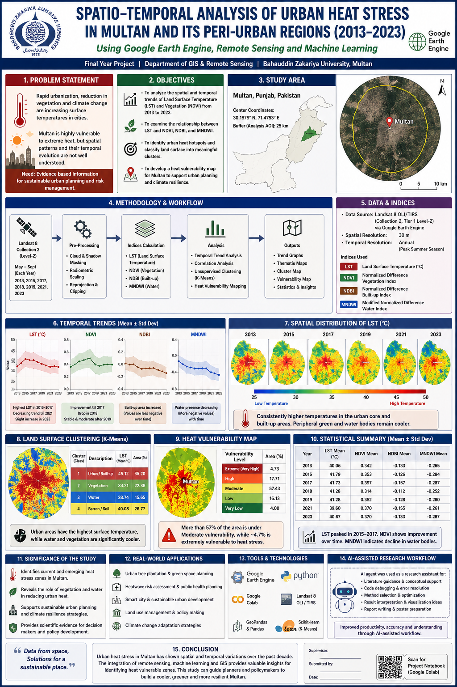

# Multan Urban Heat Island and Heat-Stress Analysis (2013–2023)

**Undergraduate environmental-science research using Landsat 8, Google Earth Engine, GIS, and clustering.**

**Researcher:** Musab Shahid · **Institution of undergraduate study:** Bahauddin Zakariya University, Multan, Pakistan

## Research overview

This project investigates spatial and temporal differences in land surface temperature and land-cover indicators in Multan, Pakistan, during selected years from 2013 to 2023. It examines the relationships between urban/built-up surfaces, vegetation, water, and observed land surface temperatures.

**Important distinction:** Landsat-derived land surface temperature (LST) is not identical to near-surface air temperature or measured human heat exposure. The analysis is a remote-sensing assessment, not a direct epidemiological estimate of heat stress.

## Data and workflow

- **Imagery:** Landsat 8 Collection 2 Tier 1 Level 2 surface reflectance and surface temperature products, processed in Google Earth Engine.
- **Study design:** Multan and its peri-urban surroundings, with selected warm-season observations across 2013–2023.
- **Spectral indicators:** NDVI (vegetation), NDBI (built-up surfaces), and MNDWI (water-related signal).
- **Analysis:** LST mapping, descriptive comparisons across land-cover categories, LST–NDVI associations, and exploratory K-Means clustering to group surface characteristics.
- **Tools:** Google Earth Engine, Python/Google Colab, geemap, pandas, NumPy, Matplotlib.

The original report provides the exact analytical specifications and results. No new independent execution or statistical verification was performed in preparing this documentation.

## Published research materials

| File | Description |
| --- | --- |
| [FYP research report](FYP_Multan_UHI_Report.pdf) | Original report; historical research artifact |
| [Final project poster](fyp-canva-poster.png) | Visual overview of the research |
| [Colab code export (PDF)](fyp.ipynb%20-%20Colab%20Code.pdf) | Archival PDF export of code/output; **not** an executable notebook |

## Interpretation and limitations

- Maps and summary statistics reflect the selected satellite scenes and processing decisions; they do not directly measure air-temperature exposure.
- Clustering is an **unsupervised** grouping procedure; cluster labels should not be treated as independently validated ground-truth land-cover classes.
- Seasonal sampling, cloud masking, spatial resolution, and land-cover mixtures constrain comparisons.
- The repository currently provides a **PDF code export**, not a clean-running `.ipynb` and not a complete raw-data archive. Full reproduction cannot be claimed from these files alone.
- The original research report and poster have not been altered for this documentation update.

## Related work

- [Drought Event Analysis in South Punjab (2001–2025)](https://github.com/musab-shahid/south-punjab-drought-analysis) — multi-sensor drought-event and vegetation-response analysis.
- [Multan ERA5 Monsoon Analysis (2016–2025)](https://github.com/musab-shahid/multan-era5-monsoon-analysis) — **collaborative four-contributor** reanalysis study.

## Portfolio publication note

A proposed [GitHub profile README](docs/GITHUB_PROFILE_README_DRAFT.md) is provided for review. Publishing that profile requires a separate public repository named `musab-shahid` under the same account.

## License

See [LICENSE](LICENSE). The original scientific report, poster, external datasets and imagery may carry separate rights or attribution requirements; do not assume the code-oriented MIT license overrides third-party terms.
